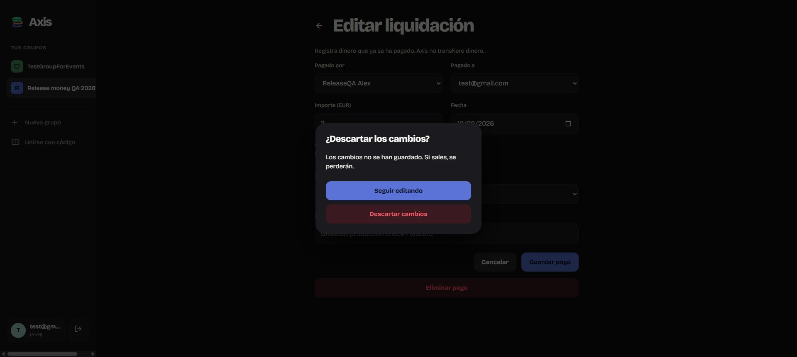
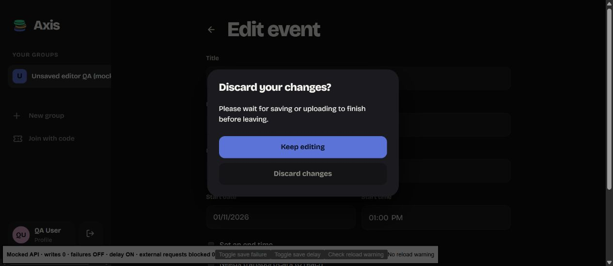
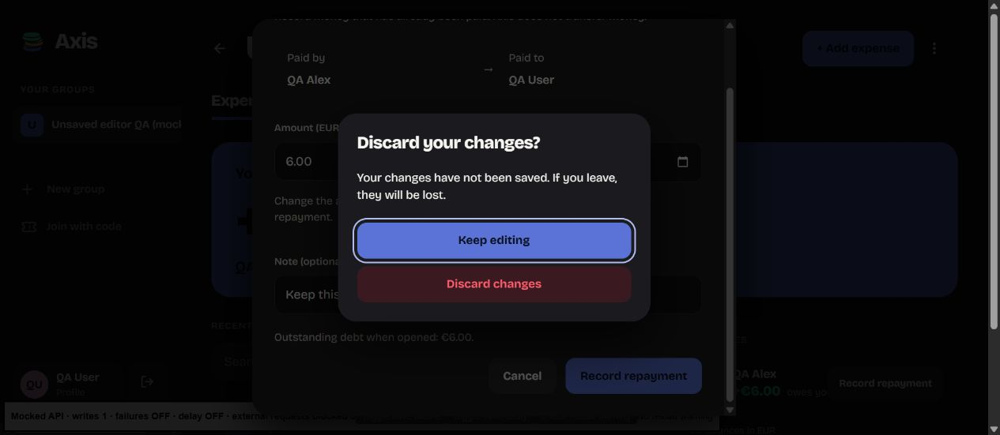
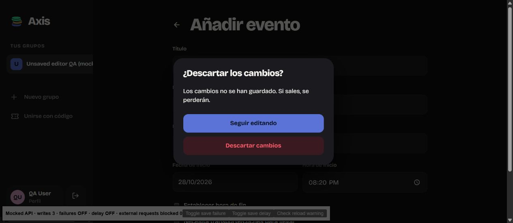

# Event and repayment unsaved changes — 28 October 2026

This extends F03 beyond the earlier expense/recurring editor protection.

## Production web release

Deployed with `npm run deploy --prefix webapp`. Cloudflare version:
`a83cf761-25aa-49e7-affd-e7a27f1893eb`. Post-deploy checks passed for the expected
home/profile shell and JavaScript entry. Production browser checks opened the
retained QA repayment `26bd029b-ac56-4092-af1b-0ac05de381ab` and QA event
`6d4475fa-2225-4b8f-8fab-67a6c306d8cb` in group
`748105b2-84f8-4ec6-9a89-81b2181e603f`. Changing the note/location and choosing
Cancel/Back showed Spanish discard confirmation. Both temporary edits were
discarded; no production record was saved or deleted in this pass.

## Implementation

Web events now use the existing route blocker and browser-unload guard. Loaded
snapshots are keyed by account/group/event, so token refreshes do not reload an
edited form. Baselines are captured after loading; inactive end-time values are
ignored. Editable fields are disabled during writes. Failed saves retain the
draft and protection; confirmed saves/deletes bypass the leaving warning.

Repayment snapshots include payer, recipient, amount, currency, date and note.
Equivalent valid dot/comma amounts compare equally; invalid text is preserved.
The existing parent-page blocker handles repayment editing and creation with
one blocker per route. Cancel, Escape and backdrop closure use the same discard
decision as navigation. Keep editing is the default; Discard is unavailable
while saving. A confirmed repayment write clears protection before refresh,
so a refresh failure does not invite a duplicate save.

Android AddEventPage and SettlementPage share GuardedEditorPage, using the
existing Shell navigation-deferral pattern and localized native confirmation.
Their view models capture complete form baselines and mark only confirmed
writes as committed. Pending writes cancel navigation. Event creation commits
its guard after the event row saves; a later automatic-RSVP failure does not
turn that committed creation into an invitation to save another event.

This is navigation protection, not persisted drafts or crash recovery.

## Web verification

Isolated browser checks used `tests/unsaved.vite.config.ts` with synthetic
accounts/records and intercepted backend calls. No real backend records were
written in these fixture checks. Failure/delay controls affected mocked writes.
The fixture retains three successful local writes: an event edit, repayment
creation and repayment edit. Its balance and display metadata are fixed test
responses, not an arithmetic test.

- Edited event: sidebar navigation prompted; Keep editing retained values.
- Reverting the title removed the synthetic beforeunload warning.
- A failed event save retained description text and navigation protection.
- A delayed event save blocked Back and disabled Discard. Successful completion
  dismissed the warning and navigated to the saved event without another prompt.
- A new event with only a location entered still prompted on Back, in Spanish.
  Discard left without writing the incomplete form.
- Repayment edit: `2` versus `2,00` did not trigger an unload warning. Changing
  the note prompted on Cancel; Discard left with a single confirmation.
- Pristine repayment creation closed immediately. Changed creation prompted on
  Escape and browser Back. Keep editing restored the note. Discard closed
  without a write.
- Failed repayment save retained its note and still prompted on Cancel.
- Escape during a delayed repayment save showed the pending message with
  Discard disabled. Success closed both dialogs without a further warning.
- A successful repayment edit returned to the group without a discard prompt.

Beforeunload checks above dispatched a cancelable test event; this pass did not
separately exercise every browser's native close/reload confirmation. Backdrop
closure shares the tested Escape handler but was not separately clicked.

Both clients' pure snapshot regressions cover all editable fields, reverted
values/equivalent money formatting, inactive end fields and invalid amounts.
Existing UnsavedEditGuard tests cover pristine, pending, failure-retained and
committed states. All **24 web tests** and the C# domain runner pass, including
30,030 split scenarios and the 40 shared input cases. Web production build and
lint pass with warnings. `git diff --check` passes.

## Android installation and limits

- Device: M2007J3SY / apollo_eea, serial `f54f4285`, `arm64-v8a`.
- Clean build: `dotnet build AxisApp/AxisApp.csproj -f net10.0-android -p:RuntimeIdentifier=android-arm64 -p:EmbedAssembliesIntoApk=true -v:q`.
- Result: **0 errors, 55 warnings**, 2 minutes 18 seconds.
- APK: `AxisApp/bin/Debug/net10.0-android/android-arm64/com.aitorsansal.axisapp-Signed.apk`, 63,874,727 bytes.
- Archive verification: **382 managed entries**, including AxisApp, with ARM64
  `libmonodroid.so`, `libmonosgen-2.0.so` and `libSkiaSharp.so` present.
- Installed with `adb install -r`; version **1.1.0 (10)**, device-reported
  `lastUpdateTime=2026-10-28 20:16:55`. Existing account/data were preserved.
- Launched through the package launcher; process `7697` remained alive across
  subsequent checks. The crash buffer contained an older 26 October crash;
  no new matching crash was observed in the inspected buffer.
- Deleting build folders was blocked by automatic approval review. The verified
  app `bin`/`obj` were instead moved to
  `C:/Users/aitor/AppData/Local/Temp/AxisApp-forms-unsaved-ddbbc8a4f4c34ebe887fbb86fd1e2713/`
  before rebuilding, preserving old artifacts.

The available Windows phone-view binding did not expose the Android app UI.
Native tap-through tests for Back/Cancel, Keep/Discard, successful saves and
pending writes therefore remain **unverified**. Installation/process checks
and pure regression coverage must not be presented as physical UI acceptance.
Prior Android expense/recurring checks remain in ANDROID_UNSAVED_REVIEW.md.

## Evidence

## Physical Android check — 29 October 2026

With build 1.1.0 (10) installed on M2007J3SY, the user reported that the
unsaved-change protection works on the phone. The prompt is the standard native
Android alert (`DisplayAlertAsync` inside the Shell navigation deferral), not
the styled dialog the web app uses; this is the implemented design.

The report was a single overall confirmation by the user. Individual outcomes
for event editing, repayment editing, Keep versus Discard, and the absence of a
prompt for an untouched form were not itemised, and no screenshots were taken.
Pending-save blocking and successful-save bypass were not exercised.
