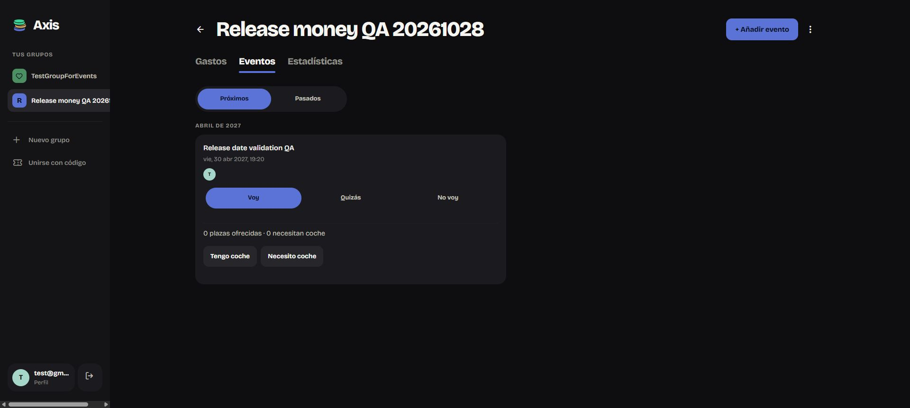

# Live attendance and transport — 28 October 2026

F02 now has repeated production web checks, additional recovery/race protection,
and an installed Android polling fallback. Android physical UI acceptance and a
real network-outage test remain open.

## Production web observations

The existing Spanish test session opened two independent tabs against the
retained event `6d4475fa-2225-4b8f-8fab-67a6c306d8cb` in the isolated group
`748105b2-84f8-4ec6-9a89-81b2181e603f`. Both tabs used the same account, not
different group members. Transport was temporarily enabled for the checks.

Measured action-to-observer observations before hardening:

| Action | Observer result | Elapsed |
| --- | --- | --- |
| Change Maybe to Going | Second event detail selected Going | 1.05 s |
| Offer the profile's four seats | Second detail displayed four seats | 1.09 s |
| Change Going/offering to Maybe | Second detail selected Maybe and showed zero seats | 0.96 s |
| Reduce offered seats from four to three in the Events list | Other tab's event detail showed three seats | 1.83 s |

These are individual UI observations, not a latency guarantee or benchmark.
The observer pages updated without manual reload. Going and offered-seat
changes also propagated from event detail to an already-open Events list.

Two nearly simultaneous clicks (Going versus Not going) initially produced
different local displays, then both tabs converged to Not going without reload.
The later convergence was checked about 57 seconds after dispatch, so this
does not establish the exact conflict-convergence latency. Same-row edits
remain **last write wins**; independent clients do not merge conflicting
intent or provide a conflict-resolution UI.

After deploying the changes below, both views were reloaded to use the new
build. Maybe again cleared the offered seats in the open Events list. A
Going-then-offer-four sequence reached the list in 4.16 seconds total across
the two sequential actions. The retained event was finally restored to its
original **Going, no car offer, transport disabled** state. No ledger records,
invitations or other groups were changed; the QA event's edit/audit timestamps
can reflect these checks.

## Web changes and recovery tests

- A successful initial Realtime subscription now refetches, closing the gap
  between initial loading and subscription readiness. Reconnect also refetches.
- Window focus now triggers recovery in addition to visibility change, online
  events and the existing 60-second visible poll.
- Late responses cannot replace newer reads or local RSVP/optimistic seat
  changes. Each request checks its read sequence and mutation revision before
  applying data. An older queued-write callback cannot cancel a newer read.
- Token refreshes no longer recreate these loaders solely because the session
  object changed. Background refresh rejections are caught so later recovery
  signals can retry.

The isolated `tests/live.vite.config.ts` fixture uses a mock Supabase channel
and visible controls for subscription, change, focus and online signals. It
verified initial subscription refresh, deferral while a write is pending,
refresh after pending clears, focus/online recovery, a rejected refresh and a
successful reconnect retry. These are **simulated recovery signals**, not an
actual internet disconnection or server outage. Preliminary fixture runs had
an ineffective Vite mock replacement and are excluded from recovery evidence;
the corrected pre-resolution replacement was confirmed in the served module,
then subscription/recovery checks were repeated. No fixture backend writes
were issued. Subscription cleanup was inspected in source; fixture unmount
metrics were inconclusive during hot reload (duplicate fixture-root warnings)
and are not acceptance evidence. The fixture root is now reused on hot reload;
that fixture-only adjustment was not used to claim additional production checks.

All **25 web tests passed**, including stale/out-of-order read and local-write
invalidation regressions. Existing C# domain regressions pass. Production
build, lint (warnings remain) and `git diff --check` passed.

Web deployment: `npm run deploy --prefix webapp`, version
`d4404ac4-6e71-4058-b87b-d7efc375bd8a`. Automatic production home/profile/entry
smoke checks passed. No SQL migration or permission change was required.

## Android behaviour and implementation

Previously the detail page's 30-second timer only updated the age caption;
an already-open page did not fetch again. It refreshed stale data on navigation
or resume, or after the viewer's own action. The group Events list had no
visible polling fallback.

Both screens now check for stale data every 30 seconds while visible. Once
data is at least 60 seconds old, they refetch; this means roughly **60–90 seconds
between successful idle refreshes**, plus network latency. Navigation back to
the page, selecting the Events tab, app resume and regained Internet access
request an immediate refresh when the model is ready. Timers stop when the
window stops or the page disappears; the list only refreshes on its Events tab.
This is bounded polling, **not Android Realtime**.

Refreshes skip pending writes and overlapping background reads. Write revisions
are advanced when a local action starts, and full loads/refetches reject data
overtaken by another write, load or route. Detail refreshes include event
metadata as well as attendees so transport settings do not remain stale.
Failed background fetches preserve displayed data; the detail age caption
continues to show its freshness. The group list still has no freshness caption.

## Android deployment and limits

- Connected device: M2007J3SY / apollo_eea, serial `f54f4285`, ARM64.
- Final clean build: 0 errors, 55 warnings, 2 minutes 42 seconds.
- APK: `AxisApp/bin/Debug/net10.0-android/android-arm64/com.aitorsansal.axisapp-Signed.apk`, 63,878,823 bytes.
- Archive checked for 382 embedded managed entries including AxisApp, with
  ARM64 `libmonodroid.so`, `libmonosgen-2.0.so` and `libSkiaSharp.so` present.
- Installed with `adb install -r`, preserving account/data. Version 1.1.0 (10),
  device-reported update time `2026-10-28 21:06:02`; launcher started process
  `11374`, which was checked again after launch.
- Used the previously established build-output preservation fallback. Final
  prior `bin`/`obj` backup:
  `C:/Users/aitor/AppData/Local/Temp/AxisApp-attendance-final-a0d4f37b4f574d47b481c22fa0e0c1eb/`.

The available phone-view tooling still did not provide an inspectable Android
UI. Native visible polling, pause/resume, reconnect and cross-client interaction
therefore remain **unverified on the physical device**. Build/archive/install/
process checks do not establish that behaviour. No new Android RSVP was entered
in this session. Different-account/multi-member concurrency, true connectivity
loss, background operating-system throttling, sustained load and every error
path remain outside the observed coverage. F02 should not be called completely
closed across both clients.

## Physical Android check — 29 October 2026

Build 1.1.0 (10) was reinstalled with `adb install -r` on M2007J3SY (installed
17:00). The user signed in on the phone with the second group member; the web
session was the first member, in TestGroupForEvents, on the event "test noti".
The user reported results by observation; no screenshots or on-device logs were
captured.

- **Web to Android:** changing RSVP on web (Going → Maybe, 17:04:07) did not
  appear within the first moments, and did not appear after turning Wi-Fi off
  and on. It did appear after switching apps (resume refresh). A second change
  (Maybe → Going, 17:06:20) appeared on the open phone screen without any
  interaction after about one minute. This matches the implemented design: a
  30-second tick refetches only when the data is at least 60 seconds old, so
  changes arrive 60–90 seconds late. Android has no Realtime and is not instant.
- **Android to web:** a change made on the phone appeared on the open web page
  instantly (Realtime).
- **Open:** the Wi-Fi off/on reconnect refresh did not visibly trigger. A
  plausible cause is that `ConnectivityChanged` fires before the network is
  usable and the failed refetch is swallowed, leaving the next tick to catch up;
  this was not confirmed. Same-row concurrent writes remain last-write-wins.
- The Android caption "updated X ago" values were not recorded.

The event was left Going; the test account remained Not going.
