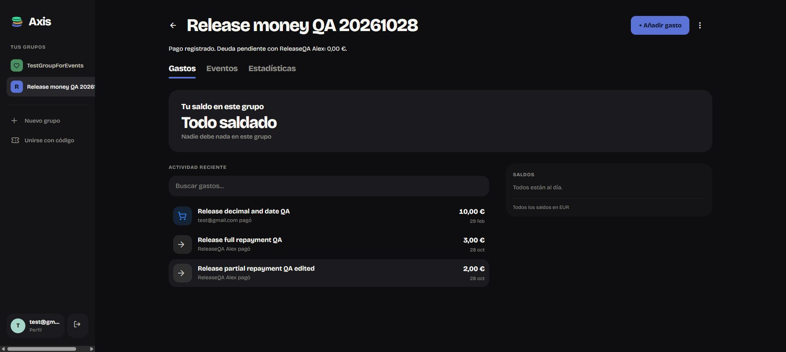

# Financial fixes: production deployment and verification

Verified 28 October 2026 against `https://app.axisapp.aitorsansal.com/` in the existing Spanish test session. This supersedes earlier statements that the web fixes were local or undeployed. No application source changed during this verification.

## Release

- Repository revision: `a103943`.
- Command: `npm run deploy --prefix webapp` (production build, then Wrangler).
- Worker: `axisapp-webapp`.
- Cloudflare version: `06ff86af-5795-49b3-b537-5340f7889d78`.
- Production loaded successfully after reload, including a nested route.
- The release also contains the existing expense unsaved-change protection and live attendance implementation. Their presence in this release does not constitute a fresh production acceptance test of those features.

## Verification

| References | Production result |
| --- | --- |
| A1 | Entering `8.50` displayed two `4,25` shares. Saving `8,50` created an EUR8.50 expense; reopening retained the amount and shares. |
| W2 | `31/02/2026` was retained and blocked with a localized date error. Correcting to `29/02/2028` saved successfully and reopened unchanged. The date also survived subsequent amount/split edits. |
| W1 | `31/04/2027` was blocked without entering a stuck Saving state. Correcting to `30/04/2027` saved successfully; the upcoming-events list showed Friday 30 April 2027 at 19:20. End-date and DST rules retain earlier local/test coverage. |
| W10/F01 | Saved Equal reopened as Equal. Changing EUR8.50 to EUR10.01 recalculated EUR5.01/EUR5.00 and retained that allocation after save/reopen. Choosing explicit Manual at EUR10.00 with EUR5.00/EUR5.00 reopened as Manual. |
| W14 | `10000000000` disabled expense Save. A manual share of `5,001` retained its text and disabled Save; correcting it to `5,00` allowed saving. Conversion limits remain open below. |
| W4/A2/F07 | Opening repayment showed the payer, recipient and EUR5.00 outstanding. Cancel left EUR5.00 and only the expense in activity. Recording EUR2.00 reduced debt to EUR3.00; recording the remaining EUR3.00 cleared it. No real money moved. |
| W7/A8 | The saved EUR2 repayment reopened in the dedicated editor with one payer, one recipient, amount, date, currency and note. Editing its note saved without changing the EUR3.00 remaining debt. |

Automated checks: all **21 web regressions passed**; the C# domain runner passed **30,030 split scenarios**, settlement rules, the **40 shared amount-input fixtures**, split intent and unsaved-edit checks. Production build passed. Lint completed with existing warnings.

## Retained isolated records

Only the new **Release money QA 20261028** group was modified. Existing user ledger records were not edited. The synthetic guest generated the app's normal invitation artifacts; no invitation was sent to another person.

- Group: `748105b2-84f8-4ec6-9a89-81b2181e603f`, EUR.
- Guest ReleaseQA Alex: `836d8d9d-adc1-47f4-a74a-846598c703dd`.
- Expense: `0fd61821-4019-418a-9517-77a26178440e`, final EUR10.00, Manual EUR5.00/EUR5.00, 29 February 2028.
- Partial repayment: `26bd029b-ac56-4092-af1b-0ac05de381ab`, EUR2.00, note `Release partial repayment QA edited`.
- Full remaining repayment: `e038f160-1937-4f95-88bf-9bfa13eefa95`, EUR3.00, note `Release full repayment QA`.
- Event: `6d4475fa-2225-4b8f-8fab-67a6c306d8cb`, `Release date validation QA`, 30 April 2027 at 19:20, no recurrence.
- Final pairwise debt: EUR0.00. No recurring template was created.

## Remaining limits

W14 is not fully closed. Source inspection confirms that `amount` and `amount_in_group_currency` both use `numeric(12,2)`, while the currency trigger assigns the converted value without a dedicated range check. An accepted source amount can exceed the stored converted-amount limit when multiplied by a rate greater than one. This is a source-derived boundary gap, not a newly reproduced production failure; no oversized converted record was submitted. Conversion-aware validation and a useful error on both clients remain follow-up work.

Android verification remains the earlier physical-device evidence in AMOUNT_INPUT_REVIEW.md, ANDROID_SETTLEMENT_REVIEW.md and ANDROID_SPLIT_MODE_REVIEW.md. This session did not rebuild/reinstall Android, alternate one record between clients, create a recurring schedule, test concurrent repayments, inject a post-commit failure or exercise every currency/database constraint. Passing these checks does not close those coverage limits.
