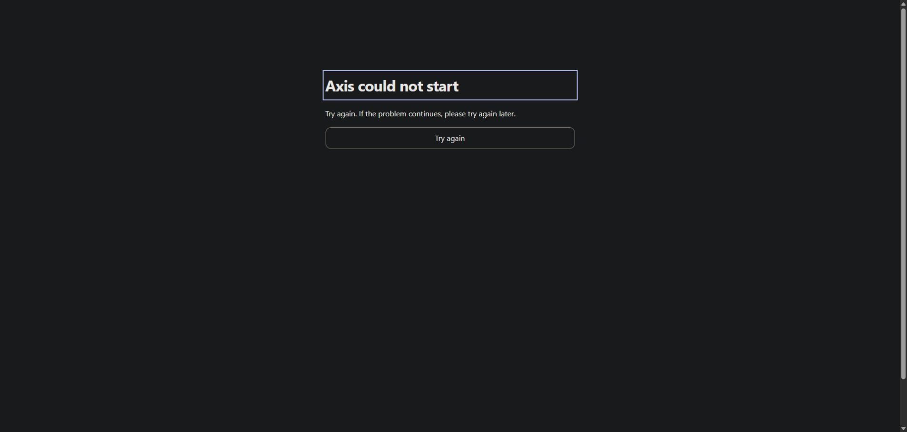
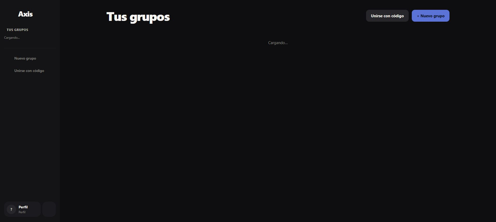

# Startup and deployment safeguards — 28 October 2026

U01's original missing-Supabase-configuration incident recovered during review.
The prevention and readable-startup safeguards are now deployed.

## Changes

- The actual Vite build configuration validates required client settings before
  generating assets. Missing/blank URL or public key, malformed/non-HTTP URLs,
  credential-bearing URLs, unchanged example values and new-format secret keys
  fail the build. Diagnostics name the setting without printing its value.
- The browser validates the same settings before dynamically importing App.
  Import/startup failures and uncaught React render failures show a focused,
  accessible retry screen in English or Spanish. The language follows the saved
  app override, then the browser. Configuration details are not shown to users.
- Failure to read a stored accent preference no longer prevents startup.
- Static HTML contains a loading/reload message and a JavaScript-disabled
  explanation, so a failed module download does not leave an empty root.
- `npm run deploy --prefix webapp` now builds, deploys and runs an HTTP smoke
  check. It checks `/`, `/profile` SPA fallback and availability of the exact
  JavaScript entry from the local production build. Up to three attempts allow
  for release propagation. It fails the command if the expected build is not
  served; it does not roll back automatically.
- `webapp/README.md` documents build-time variables, smoke checks and the
  isolated failure fixture. Firebase notification setup remains separate.

## Verification

- **23 web regression tests passed**, including required-setting checks and
  actual Vite build-config resolution against an empty temporary env directory,
  URL-only configuration, valid `.env.production` settings and an empty process
  environment override. Original local environment files were not modified.
- Production TypeScript/Vite build passed. Lint completed with the existing
  warnings; `git diff --check` passed.
- An isolated Vite fixture on `127.0.0.1:5175` removed the browser's Supabase
  settings. The browser displayed **Axis could not start**, explanatory copy and
  **Try again**. Retry reloaded and returned to the same readable failure.
- Deployment command succeeded, including the new HTTP smoke check.
- Fresh production browser loads of `/` and `/profile` completed successfully
  with the existing test login and loaded localized content. No profile or
  ledger records were modified during these checks.

Cloudflare Worker: `axisapp-webapp`.
Version: `f3107844-b5a7-4a63-96b1-9638e463740b`.
Host: `https://app.axisapp.aitorsansal.com/`.

## Limits

The runtime failure fixture was local; production configuration was never
deliberately broken. The screenshot verifies the English recovery screen;
Spanish text and preference selection are implemented but were not separately
exercised in this browser pass. Uncaught render failures, a blocked preference
store and failed JavaScript downloads have defensive paths but were not
separately fault-injected. HTTP smoke checks establish the expected shell and
entry asset, while the browser checks establish startup; neither establishes
every authenticated workflow or notification delivery. A manual bare Wrangler
deployment can still bypass the documented npm pipeline.
